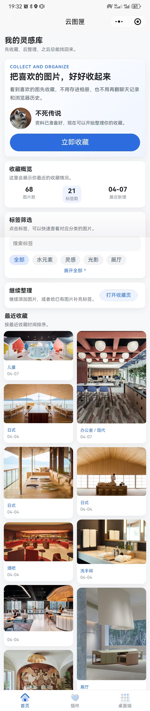
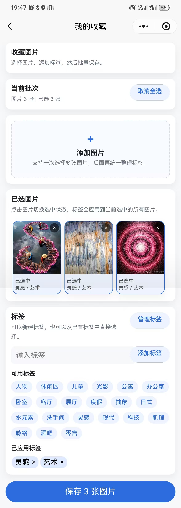
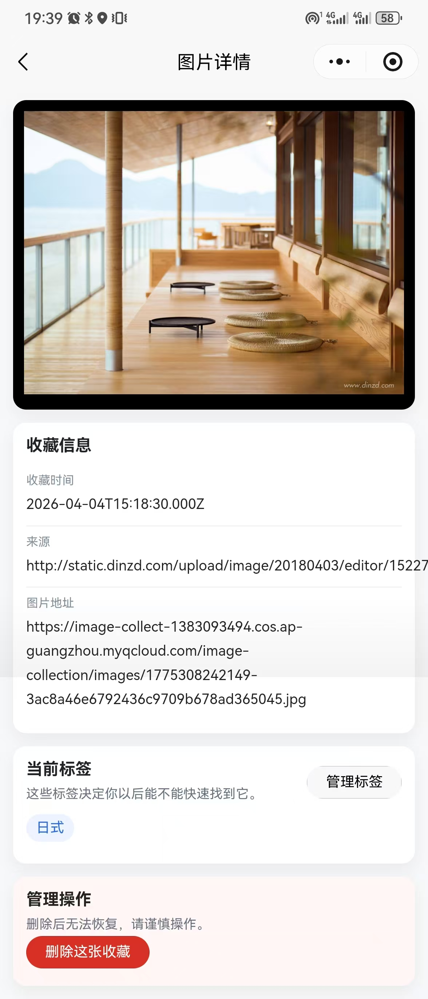
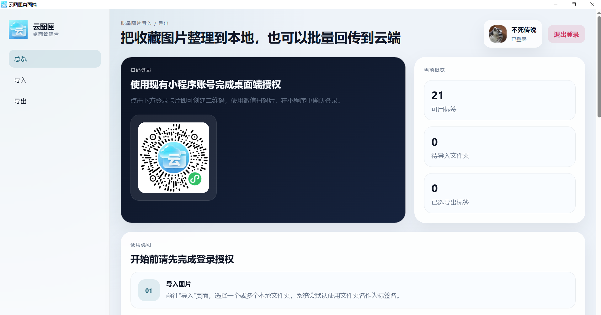

# 云图匣

云图匣是一个围绕“图片收藏、标签整理、跨端同步”构建的项目，当前包含 4 个可协同使用的端：

- `backend/`：Spring Boot 后端，负责登录、图片、标签、上传、导出、插件/桌面端扫码登录等能力
- `frontend/`：uni-app 微信小程序
- `plugin/`：浏览器插件，用于网页图片右键收藏
- `desktop/`：Electron 桌面端，用于批量导入本地文件夹、按标签导出图片到本地

项目当前支持：

- 微信小程序登录
- 图片收藏与标签管理
- 浏览器插件扫码登录确认
- 桌面端扫码登录确认
- 本地存储或腾讯云 COS 存储
- 桌面端批量导入 / 导出

## 项目结构

```text
.
├─assets/                      README 截图等静态资源
├─backend/                     Spring Boot + MyBatis + MySQL
├─desktop/                     Electron 桌面端
├─frontend/                    uni-app 微信小程序
├─plugin/                      浏览器插件
├─DEPLOY_TENCENT.md            腾讯云部署说明
└─README.md
```

## 技术栈

### 后端

- Java 17
- Spring Boot 4.0.4
- MyBatis
- Flyway
- MySQL
- Redis
- 腾讯云 COS SDK

### 小程序

- uni-app
- Vue 3 `<script setup>`
- 微信小程序

### 插件

- Chrome / Edge Extension
- Manifest V3

### 桌面端

- Electron
- electron-builder

## 核心功能

### 微信小程序

- 首页图片流和标签筛选
- 图片收藏页
- 图片详情页
- 协议页
- 插件安装说明页
- 桌面端安装说明页
- 插件 / 桌面端扫码登录确认

### 浏览器插件

- 网页图片右键收藏
- 弹窗扫码登录
- 补充标签后保存

### 桌面端

- 启动后自动生成登录二维码
- 批量选择本地文件夹导入
- 默认以文件夹名作为标签名，可修改
- 选择多个标签导出到本地目录
- 按标签自动创建文件夹

## 运行要求

- JDK 17
- Node.js 18+
- MySQL 8
- 微信开发者工具
- HBuilderX 或 uni-app 对应开发环境

## 后端配置

后端默认入口配置在：

- [application.yaml](/F:/01%20Project/001_image-Collection-System/backend/src/main/resources/application.yaml)
- [application-prod.example.yaml](/F:/01%20Project/001_image-Collection-System/backend/src/main/resources/application-prod.example.yaml)

本地和生产环境的真实配置文件默认不提交：

- `backend/src/main/resources/application-local.yaml`
- `backend/src/main/resources/application-prod.yaml`

主要环境变量：

- `DB_URL`
- `DB_USERNAME`
- `DB_PASSWORD`
- `WECHAT_MINIAPP_APP_ID`
- `WECHAT_MINIAPP_SECRET`
- `WECHAT_MINIAPP_CODE_ENV_VERSION`
- `STORAGE_PUBLIC_BASE_URL`
- `COS_SECRET_ID`
- `COS_SECRET_KEY`
- `COS_REGION`
- `COS_BUCKET`
- `COS_PUBLIC_URL_PREFIX`
- `COS_KEY_PREFIX`

## 本地开发

### 1. 后端

启动：

```bash
cd backend
./gradlew bootRun
```

Windows：

```powershell
cd backend
.\gradlew.bat bootRun
```

构建 jar：

```bash
cd backend
./gradlew clean bootJar
```

默认端口：

```text
8080
```

### 2. 数据库

初始化迁移文件：

- [V1__init_schema.sql](/F:/01%20Project/001_image-Collection-System/backend/src/main/resources/db/migration/V1__init_schema.sql)

默认数据库名：

```text
image_collection
```

核心表：

- `user`
- `user_session`
- `image`
- `tag`
- `image_tag`

### 3. 微信小程序

目录：

```text
frontend/
```

开发方式：

- 使用 HBuilderX 打开 `frontend/`
- 运行到微信开发者工具

基础地址配置：

- [base-url.js](/F:/01%20Project/001_image-Collection-System/frontend/utils/base-url.js)

### 4. 浏览器插件

目录：

```text
plugin/
```

使用方式：

- 在 Chrome / Edge 扩展管理页加载已解压的扩展程序
- 选择 `plugin/` 目录

### 5. 桌面端

目录：

```text
desktop/
```

安装依赖：

```bash
cd desktop
npm install
```

开发运行：

```bash
npm run dev
```

打包：

```bash
npm run build
```

产物目录：

```text
desktop/release/
```

## 发布说明

### 插件

插件通常发布为 zip 包，上传到 COS 或静态资源站后，在小程序“插件”说明页中提供下载地址。

### 桌面端

桌面端使用 `electron-builder` 打包 Windows 安装包，上传到 COS 后，在小程序“桌面端”说明页中提供下载地址。

### 小程序

小程序可使用 HBuilderX 构建后，通过微信开发者工具上传开发版、体验版或正式版。

## 截图

### 首页



### 收藏页



### 插件安装说明页


### 桌面端安装说明页


### 详情页



### 协议页


### 插件


### 桌面端



## 部署

腾讯云服务器部署说明见：

- [DEPLOY_TENCENT.md](/F:/01%20Project/001_image-Collection-System/DEPLOY_TENCENT.md)
