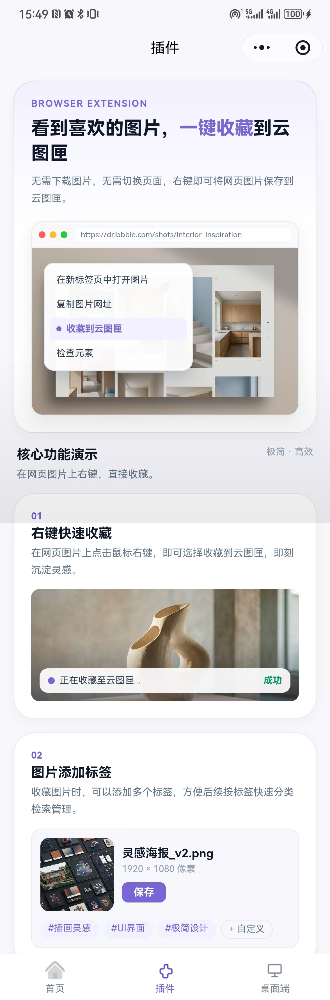
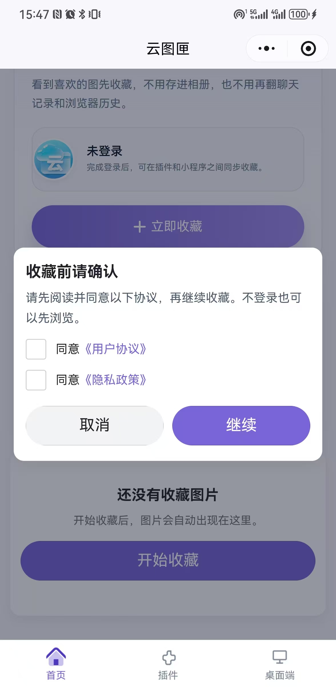
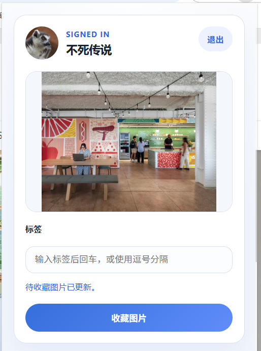

# 云图匣

云图匣是一个围绕“图片收藏、标签整理、跨端同步”构建的项目，当前包含 4 个可协同使用的端：

- `backend/`：Spring Boot 后端，负责登录、图片、标签、上传、导出、插件/桌面端扫码登录，以及水印相机项目、成员邀请、站内消息、水印成片生成等能力
- `frontend/`：uni-app 微信小程序（图片收藏 + 水印相机）
- `plugin/`：浏览器插件，用于网页图片右键收藏
- `desktop/`：Electron 桌面端，用于批量导入本地文件夹、按标签导出图片到本地

项目当前支持：

- 微信小程序登录
- 图片收藏与标签管理
- 水印相机：拍照写入时间、地点、天气、备注水印，按项目归档并支持多人协作
- 浏览器插件扫码登录确认
- 桌面端扫码登录确认
- 本地存储或腾讯云 COS 存储
- 桌面端批量导入 / 导出

## 项目结构

```text
.
├─assets/                      README 截图等静态资源
├─backend/                     Spring Boot + MyBatis + MySQL
├─desktop/                     Electron 桌面端
├─frontend/                    uni-app 微信小程序
├─plugin/                      浏览器插件
├─DEPLOY_TENCENT.md            腾讯云部署说明（部署相关说明以该文件为准）
└─README.md
```

## 技术栈

### 后端

- Java 17
- Spring Boot 4.0.4
- MyBatis（XML Mapper）
- Flyway（Spring Boot 4 需同时引入 `spring-boot-flyway` 与 `flyway-mysql`，否则迁移不会执行）
- MySQL
- Redis
- 腾讯云 COS SDK
- Java2D 水印成片渲染（内置 Noto Sans SC 字体）
- 第三方服务：腾讯位置服务（逆地理编码）、和风天气（Ed25519 JWT）、腾讯云语音识别

### 小程序

- uni-app
- Vue 3 `<script setup>`
- 微信小程序

### 插件

- Chrome / Edge Extension
- Manifest V3

### 桌面端

- Electron
- electron-builder

## 核心功能

### 微信小程序

- 首页图片流和标签筛选
- 图片收藏页
- 图片详情页
- 协议页
- 插件安装说明页
- 桌面端安装说明页
- 插件 / 桌面端扫码登录确认

### 水印相机（小程序）

页面位于 `frontend/pages/watermark/`：

- 水印相机首页：当前拍摄项目、选择项目、项目成员、最近项目照片（按日期筛选）、项目回收站
- 拍照页：镜头缩放、闪光灯（自动 / 关闭 / 常亮）、前后摄像头切换、横拍时水印随手机方向横放
- 水印内容：项目名称、备注内容、拍摄时间、地点、天气（天气默认关闭），可在设置中开关
- 备注：手动输入，或按住说话转文字，确认后写入水印
- 预览与记录页：预览水印样式并保存；原图保存到手机相册（需相册权限）
- 照片详情页：左右滑动切换照片，查看原图 / 带水印成片，删除照片
- 项目协作：创建项目、邀请成员（邀请链接，接受 / 拒绝）、成员改名与移除、转让所有者、归档与彻底删除、站内消息
- 水印照片与收藏相互独立：水印相机上传的原图以 `origin=project` 保存，不会出现在首页和收藏页

### 浏览器插件

- 网页图片右键收藏
- 弹窗扫码登录
- 补充标签后保存

### 桌面端

- 启动后自动生成登录二维码
- 批量选择本地文件夹导入
- 默认以文件夹名作为标签名，可修改
- 选择多个标签导出到本地目录
- 按标签自动创建文件夹

## 运行要求

- JDK 17
- Node.js 18+
- MySQL 8
- 微信开发者工具
- HBuilderX 或 uni-app 对应开发环境

## 后端配置

后端默认入口配置在：

- [application.yaml](/F:/01%20Project/001_image-Collection-System/backend/src/main/resources/application.yaml)
- [application-prod.example.yaml](/F:/01%20Project/001_image-Collection-System/backend/src/main/resources/application-prod.example.yaml)

本地和生产环境的真实配置文件默认不提交：

- `backend/src/main/resources/application-local.yaml`
- `backend/src/main/resources/application-prod.yaml`

主要环境变量：

- `DB_URL`
- `DB_USERNAME`
- `DB_PASSWORD`
- `WECHAT_MINIAPP_APP_ID`
- `WECHAT_MINIAPP_SECRET`
- `WECHAT_MINIAPP_CODE_ENV_VERSION`
- `STORAGE_PUBLIC_BASE_URL`
- `COS_SECRET_ID`
- `COS_SECRET_KEY`
- `COS_REGION`
- `COS_BUCKET`
- `COS_PUBLIC_URL_PREFIX`
- `COS_KEY_PREFIX`

水印相机相关（不配置时对应功能不可用，不影响图片收藏）：

- `TENCENT_LBS_KEY`：腾讯位置服务 Key，用于逆地理编码
- `QWEATHER_API_HOST`：和风天气 API 域名，默认 `devapi.qweather.com`
- `QWEATHER_PRIVATE_KEY_PATH` 或 `QWEATHER_PRIVATE_KEY`：Ed25519 私钥（路径或内容，二选一）
- `QWEATHER_KID`、`QWEATHER_PROJECT_ID`：和风天气凭据 ID 与项目 ID
- `QWEATHER_JWT`、`QWEATHER_DEV_ID`：静态 Token / 开发者 ID，仅调试时使用
- `TENCENT_SPEECH_SECRET_ID`、`TENCENT_SPEECH_SECRET_KEY`：腾讯云语音识别密钥

私钥文件和密钥不要提交到仓库。

## 本地开发

### 1. 后端

启动：

```bash
cd backend
./gradlew bootRun
```

Windows：

```powershell
cd backend
.\gradlew.bat bootRun
```

构建 jar：

```bash
cd backend
./gradlew clean bootJar
```

默认端口：

```text
8080
```

### 2. 数据库

迁移文件由 Flyway 在后端启动时自动执行：

- [V1__init_schema.sql](/F:/01%20Project/001_image-Collection-System/backend/src/main/resources/db/migration/V1__init_schema.sql)：用户、会话、图片、标签
- [V2__batch2_project_tables.sql](/F:/01%20Project/001_image-Collection-System/backend/src/main/resources/db/migration/V2__batch2_project_tables.sql)：水印相机项目相关表
- [V3__image_origin.sql](/F:/01%20Project/001_image-Collection-System/backend/src/main/resources/db/migration/V3__image_origin.sql)：`image` 表新增 `origin` 字段（`collect` 收藏 / `project` 水印相机），并回填历史水印照片

默认数据库名：

```text
image_collection
```

核心表：

- `user`
- `user_session`
- `image`（`origin` 区分收藏与水印相机原图）
- `tag`
- `image_tag`
- `project`
- `project_member`
- `project_photo`
- `project_invite`
- `project_invite_acceptance`
- `user_message`

注意：

- 线上库升级前先用 `mysqldump` 备份。
- 如果本地库已手动建过表、没有 Flyway 历史，启动会因迁移校验失败而报错；本地可设置 `SPRING_FLYWAY_ENABLED=false` 跳过，或自行修复历史表。

### 3. 微信小程序

目录：

```text
frontend/
```

开发方式：

- 使用 HBuilderX 打开 `frontend/`
- 运行到微信开发者工具

基础地址配置：

- [base-url.js](/F:/01%20Project/001_image-Collection-System/frontend/utils/base-url.js)
- 仅「开发版」（开发者工具、预览、真机调试）连接本机后端，体验版和正式版固定使用线上域名 `https://api.yuntuxia.top`
- 可通过环境变量 `UNI_APP_BASE_URL` 显式指定；不想连本机后端时，把 `USE_LOCAL_BACKEND` 改为 `false`
- 开发版默认地址 `DEV_BASE_URL` 是局域网 IP，换网络后需要改成自己电脑的地址

### 4. 浏览器插件

目录：

```text
plugin/
```

使用方式：

- 在 Chrome / Edge 扩展管理页加载已解压的扩展程序
- 选择 `plugin/` 目录

### 5. 桌面端

目录：

```text
desktop/
```

安装依赖：

```bash
cd desktop
npm install
```

开发运行：

```bash
npm run dev
```

打包：

```bash
npm run build
```

产物目录：

```text
desktop/release/
```

## 发布说明

### 插件

插件通常发布为 zip 包，上传到 COS 或静态资源站后，在小程序“插件”说明页中提供下载地址。

### 桌面端

桌面端使用 `electron-builder` 打包 Windows 安装包，上传到 COS 后，在小程序“桌面端”说明页中提供下载地址。

### 小程序

小程序可使用 HBuilderX 构建后，通过微信开发者工具上传开发版、体验版或正式版。

- 当前版本：`frontend/manifest.json` 中 `versionName 1.1.0`、`versionCode 110`；每次上传前先递增版本号，并在项目备注里写本次更新内容。
- 微信公众平台「开发管理 → 服务器域名」：`request`、`uploadFile`、`downloadFile` 合法域名均配置为 `https://api.yuntuxia.top`。
- 「用户隐私保护指引」需如实声明：位置信息、摄像头、麦克风、保存到相册；与 `manifest.json` 中的权限说明保持一致。
- 水印相机上传原图使用 `origin=project`，需要小程序与后端同时升级才会生效；后端先上线，再发布小程序。

### 后端

- 构建：`cd backend` 后执行 `./gradlew clean bootJar`（Windows 用 `.\gradlew.bat clean bootJar`）
- 服务器上以 `releases/` 保存历史 jar、`current.jar` 指向当前版本，部署和回滚步骤见 [DEPLOY_TENCENT.md](/F:/01%20Project/001_image-Collection-System/DEPLOY_TENCENT.md)
- 上线前建议：先备份数据库，再备份旧 jar、替换新 jar 并重启，最后检查 Flyway 迁移记录和日志

## 截图

### 首页


### 收藏页


### 插件安装说明页



### 桌面端安装说明页


### 详情页


### 协议页



### 插件



### 桌面端


## 部署

腾讯云服务器部署说明见：

- [DEPLOY_TENCENT.md](/F:/01%20Project/001_image-Collection-System/DEPLOY_TENCENT.md)
